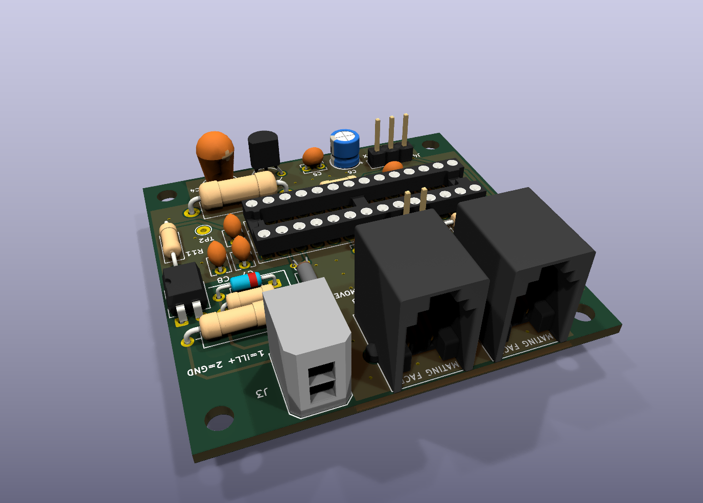
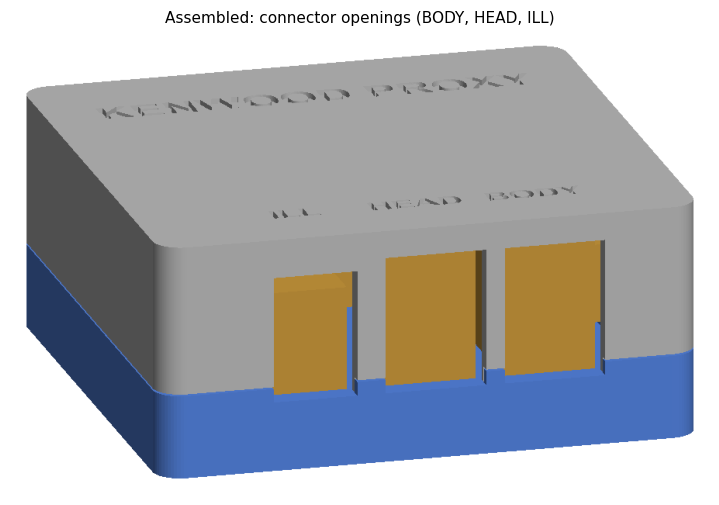

# TM-V71A display proxy

A small board that sits in the cable between a **Kenwood TM-V71A** radio and its separated control head. It sets the head's display brightness from the vehicle's lights: one brightness level with the lights off, another with them on, switching automatically.

The TM-V71A has a single display brightness setting, and level that's readable in daylight is glaring at night. This board remembers separate brightness settings depending on whether your vehicle's headlights are on or not, and switches the control head's brightness to the corresponding setting every time you toggle the headlights.

*3D render of Rev B, seen from the connector edge. J3 (grey) is a simplified stand-in model.*

## How it works

When the head is separated from the body, the two talk over a 4-wire cable: power, ground, and one serial data line in each direction (57,600 baud). The body tells the head what to show, including the display brightness, as a short message `33 <level> 0D`.

- **Power, ground and the head's key presses** pass straight through the board in copper.
- **The body's display data** goes through an AVR128DB28 microcontroller. It forwards every byte to the head as it arrives, about one byte-time (0.17 ms) late, and rewrites brightness messages on the way.
- **The vehicle's lights input** (ILL+, through an optocoupler) tells the AVR whether it's day or night. The vehicle wiring is fully isolated from the radio.
- **Learning:** set the brightness in the radio's menu once with the lights off and once with them on. The board remembers both levels in EEPROM, and sends the right one whenever the lights change or the radio powers up.
- **Power:** the board takes about 5 mA from the radio's own 10 V head supply, so it needs no other power wiring.
- **Fail-safe:** with the AVR pulled from its socket and the JP1 shunt fitted, the board is a plain pass-through.

The message format and how the radio uses it are in [docs/protocol.md](docs/protocol.md).

## Status

| | |
|---|---|
| **Rev A** (`rev-a` branch) | Built and working in the vehicle with the full firmware. Its two data lines were swapped by mistake, so it needed a small rework; the `rev-a` branch documents it. |
| **Rev B** (this branch) | Rev A with the data lines corrected, a 4-pin data-tap header (J5) for logic analyzers, and a long-lead crystal that's easier to solder. Not yet fabricated. It passes ERC, DRC with schematic parity, and 25 design checks. The firmware is shared with Rev A. |

Tested with a TM-V71A in a 2013 Toyota Tacoma. Any vehicle with a 12 V lights-on (ILL+ or TAIL) signal should work.

## Building one

1. **Order the PCB.** Upload [`hardware/fab/kenwood_proxy_revB_oshpark_gerbers.zip`](hardware/fab/kenwood_proxy_revB_oshpark_gerbers.zip) to OSH Park or any 2-layer fab: 54 × 52 mm, about $22 for three at OSH Park. See [ordering notes](hardware/fab/ORDERING.md).
2. **Order the parts.** [`BOM_upload_digikey_mouser.csv`](hardware/fab/BOM_upload_digikey_mouser.csv) uploads straight to DigiKey or Mouser. Expect about $30. All parts are through-hole.
3. **Assemble and check** with the **[assembly guide](docs/assembly.md)**. Each step has a diagram of the board with that step's parts highlighted, and the guide has the meter and power checks to do before connecting the radio.
4. **Program it** with a 5 V SerialUPDI adapter: see [firmware/README.md](firmware/README.md).
5. **Print the case** (PETG or ASA) from [`hardware/enclosure/`](hardware/enclosure/): two parts, no supports, 4 × M3 screws.

   

6. **Install.** Body cable → J1, head cable → J2. J3 → the vehicle's ILL+ (live with the parking lights) and chassis ground. Then set the brightness once with the lights off and once with them on.

## Repository layout

| Path | What |
|---|---|
| [`hardware/`](hardware/) | KiCad 10 project, Gerbers, BOMs, design checks, SPICE simulation, and the generator scripts. [Design notes](hardware/README.md). |
| [`hardware/enclosure/`](hardware/enclosure/) | Case STLs and STEP, plus the FreeCAD generator script |
| [`firmware/`](firmware/) | AVR firmware (arduino-cli + DxCore), host unit tests, serial tools |
| [`docs/assembly.md`](docs/assembly.md) | Rev B assembly and checks |
| [`docs/protocol.md`](docs/protocol.md) | The head ↔ body link, as measured |
| [`docs/captures/`](docs/captures/) | Raw captures of the radio's traffic |
| [`docs/research/`](docs/research/) | Service-manual notes on the radio's interface and the Tacoma lighting circuit |

## Safety notes

- The cable's PB line carries about 10 V. A reversed or miswired 4P4C coupler can put it on a data pin of the head. The assembly guide checks every J2 pin before the head is connected.
- **Fit the JP1 shunt only with the AVR removed.**
- The board never draws power from vehicle wiring. The lights input is opto-isolated and simulated to survive reversed wiring, 24 V and a 40 V load dump.

## License

- **Hardware** (everything under `hardware/` except the Python scripts: schematic, PCB, Gerbers, BOMs, case models): [CERN-OHL-S-2.0](LICENSE-HARDWARE).
- **Firmware, scripts and tools:** [GPL-3.0](LICENSE).
- **Documentation:** follows the hardware or software it describes.

## Credits

- The brightness message format was first published by [KK4HEJ](https://kk4hej.wordpress.com/decoding-the-tm-v71a-display-protocol/).
- The 4P4C jack footprint follows Würth Elektronik's [KiCad library](https://github.com/WurthElektronik/KiCad-Library).
- Built with KiCad, Freerouting, ngspice, FreeCAD and DxCore.

Kenwood and TM-V71A are trademarks of JVCKENWOOD Corporation. This project isn't affiliated with or endorsed by Kenwood.
