# Rev B assembly and checks

How to build a Rev B board and confirm it's assembled correctly before it goes near the radio. The design was proven on a reworked Rev A board, so this guide doesn't cover function testing: it covers soldering in the right order, polarity, and the meter and power checks that catch build mistakes.

**Diagrams.** Every step has a board diagram, drawn from the PCB file:
- The parts for that step are yellow, with their reference.
- Cyan rings mark the exact pins to probe.
- **TOP** views are the component side, connector edge at the top.
- **UNDERSIDE** views are the board flipped left-to-right like a page, connector edge still at the top. Everything is mirrored.

The silkscreen on the board is authoritative if it ever disagrees with a diagram.

## Contents

1. [Tools](#1-tools)
2. [Parts](#2-parts)
3. [Board map](#3-board-map)
4. [Bare-board checks](#4-bare-board-checks)
5. [Soldering, lowest parts first](#5-soldering-lowest-parts-first)
6. [Trim, clean, inspect](#6-trim-clean-inspect)
7. [Power checks (AVR out)](#7-power-checks-avr-out)
8. [Program the AVR](#8-program-the-avr)
9. [Radio check](#9-radio-check)
10. [Case and installation](#10-case-and-installation)
11. [Recovery](#11-recovery)

---

## 1. Tools

- **Soldering iron** with a 1.6–2.4 mm chisel tip, at about 330 °C (625 °F) for 63/37 solder. Pins on the ground pour soak heat: go 20–30 °C (35–55 °F) hotter if solder balls up instead of wetting.
- **Solder and flux:** 0.8 mm rosin-core 63/37, plus tack flux.
- **Hand tools:** flush cutters, needle-nose pliers, solder wick, and a board holder or vise.
- **Desoldering pump.** You'll want it if a part ever has to come out: wick can't clear a filled through-hole.
- **Cleaning:** 90 %+ isopropyl alcohol and a stiff brush.
- **ESD:** mat and wrist strap, for U1 and U3.
- **Multimeter.**
- **Power:** a bench supply set to 10 V with a 30 mA limit, or a 9 V battery with clip leads.
- **Programmer:** a 5 V SerialUPDI adapter. Use an Adafruit UPDI Friend, or an FT232-based USB-serial adapter plus a 2.2 kΩ resistor (see [§8](#8-program-the-avr)).
- **Calipers.** Optional: to check J3's height before printing the case.

## 2. Parts

The BOM with MPNs, alternates and buy quantities is [`hardware/fab/BOM_purchasing.csv`](../hardware/fab/BOM_purchasing.csv). The board has 27 references plus the DIP-28 socket. TP2 is a bare test pad: nothing is fitted there.

**Keep each resistor value in its own bag until its step, and meter every resistor as it comes out.** Colour bands are easy to misread, especially 470 Ω against 680 Ω.

| Ref | Part | MPN | Check |
|---|---|---|---|
| R6 R7 R11 | 10 kΩ ¼ W | MFR-25FBF52-10K | meter 9.9–10.1 kΩ |
| R2 R13 | 470 Ω ¼ W | MFR-25FBF52-470R | meter 465–475 Ω |
| R10 | 680 Ω ¼ W | MFR-25FBF52-680R | meter 673–687 Ω |
| R9 | 2.2 kΩ ½ W | MFR50SFTE52-2K2 | meter 2.18–2.22 kΩ |
| R1 | 150 Ω 1 W | FMP100JR-52-150R | meter 143–158 Ω |
| D1 | 1N4148 | 1N4148 | black band = cathode |
| Y1 | 32.768 kHz crystal, 2 × 6 mm can | AB26T-32.768KHZ | fragile leads |
| U1 | AVR128DB28, DIP-28, in a 0.3 in socket | AVR128DB28-I/SP, socket 110-43-328-41-001000 | fitted at programming |
| U3 | SFH617A-3 optocoupler, DIP-4 | SFH617A-3 | pin-1 dot |
| C1 C2 C3 C5 | 100 nF ceramic | C320C104K5R5TA | marked 104 |
| C7 C8 | 15 pF C0G | C315C150J1G5TA | marked 150 |
| JP1 J4 J5 | 1×2, 1×3, 1×4 header, from one 40-pin strip | PRPC040SAAN-RC | — |
| U2 | 5 V regulator, TO-92 | LM2936Z-5.0/NOPB or AP7381-50V-A | flat face |
| C4 | 22 µF 16 V tantalum | T350F226K016AT | **polarized**, + marked |
| C6 | 10 µF 25 V electrolytic | EEA-FC1E100 | **polarized**, stripe = − |
| J3 | Micro-Fit 3.0, 2-pin, right-angle | 43045-0200 | — |
| J1 J2 | 4P4C jack | Würth 615004143821 | J1 BODY, J2 HEAD |

**Loose items:**
- a JP1 shunt (Samtec SNT-100-BK-G or any 0.1 in jumper)
- a Micro-Fit 2-pin receptacle with pre-crimped leads, for J3
- 4 × M3 × 14–16 mm screws, for the case

## 3. Board map

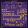

- **Connector edge (top):** J1 BODY, J2 HEAD and J3 (lights input).
- **Top right:** the ILL area (J3, R9, R10, D1, U3). It's isolated from the rest of the board, so keep it clean.
- **Inside the case:** J4 (programming), J5 (data taps) and JP1 (bypass jumper). All three are reachable only with the case open.
- **TP2** is the ground test pad.

## 4. Bare-board checks

Do these before anything is soldered. They take a minute and catch a bad board.

- [ ] **J1 ↔ J2, pin for pin**, on the underside pads:

  | Pins | Expected |
  |---|---|
  | 1 ↔ 1 (PB) | ≈ 0 Ω |
  | 2 ↔ 2 (GND) | ≈ 0 Ω |
  | 4 ↔ 4 (head → body data) | ≈ 0 Ω |
  | 3 ↔ 3 (body → head data) | **open**. This line goes through the AVR; only JP1 joins it. |

- [ ] **PB ↔ GND:** R1's left pad to TP2. Expect **open**.

  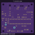

- [ ] **Dry fit** J1, J2, J3, the DIP socket and C6:
  - The jacks and J3 should drop in with their pegs seated.
  - C6's leads are 1.5 mm apart and its holes 2.0 mm, so spread the leads slightly.

## 5. Soldering, lowest parts first

**Every joint:**
1. Heat the pad and lead together for 1–2 s.
2. Feed solder into the joint, not onto the tip.
3. Take the solder away, then the iron.

Aim for a shiny, concave cone. Bend the leads out about 30° on the underside so parts stay put when you flip the board; trim them later.

**Pins that need more heat:** these are on the ground pour, so they soak heat. Give them longer, or turn the iron up a little.
- jack pin 2
- socket pins 15 and 21
- U2's middle pin
- the − pads of C4 and C6
- J4 pin 1 and J5 pin 1
- the capacitors' ground pads

### 5.1 10 kΩ: R6, R7, R11
`MFR-25FBF52-10K` · meter 9.9–10.1 kΩ

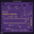

All three lie flat, with their leads bent down 10.16 mm apart. R6 and R7 run left to right. R11 runs up and down along the right edge.

### 5.2 470 Ω: R2, R13
`MFR-25FBF52-470R` · meter 465–475 Ω

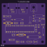

### 5.3 680 Ω: R10
`MFR-25FBF52-680R` · meter 673–687 Ω

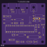

The holes are 7.62 mm apart, so bend the leads tight against the ends of the body.

### 5.4 2.2 kΩ ½ W: R9
`MFR50SFTE52-2K2` · meter 2.18–2.22 kΩ

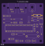

Larger body. Keep a spare from this bag if you'll build the FT232 programmer in [§8](#8-program-the-avr).

### 5.5 150 Ω 1 W: R1
`FMP100JR-52-150R` · meter 143–158 Ω

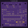

Largest body. Stand it about 1 mm off the board so it can shed heat.

### 5.6 D1 (1N4148)

> ⚠️ **Polarity.** The black band (cathode) goes to the **left**, on the square pad, matching the band on the silkscreen.

### 5.7 Y1 crystal
`AB26T-32.768KHZ`

1. Bend both leads 90° so the can lies flat on the board, pointing toward the connector edge.
   - Make the bend **at least 1.5 mm from the can** (3 mm is better), never at the glass seal.
   - Hold the lead with pliers between the bend and the can.
2. Solder from the underside. Use flux and keep each joint quick: 1–2 s per lead, with a pause between the two leads.
3. Don't glue the can yet: that comes after cleaning (§6).

- [ ] **Check the joints.** Meter from the lead wire, between the can and the board, to the socket holes. The socket isn't fitted yet, so its holes are bare pads.

  

  | Probe | Expected |
  |---|---|
  | Y1 right lead ↔ socket pin 16 | ≈ 0 Ω |
  | Y1 left lead ↔ socket pin 17 | ≈ 0 Ω |
  | Y1 lead ↔ Y1 lead | open |

### 5.8 DIP-28 socket (U1 stays out)
`110-43-328-41-001000`

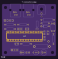

> ⚠️ **Orientation.** The notch goes to the **left**, so pin 1 is bottom-left, on the square pad.

1. The socket falls out when you flip the board. Lay a book over it, flip the two together, and let the board rest on the socket.
2. Tack two opposite corners: pin 28 (top-left) and pin 14 (bottom-right).
3. Check the socket sits flat. If it doesn't, reheat a tack and press it down.
4. Solder the other 26 pins.

### 5.9 U3 optocoupler
`SFH617A-3`, soldered directly (no socket)

> ⚠️ **Orientation.** The pin-1 dot goes **top-right**, on the square pad nearest the board's right edge.

### 5.10 100 nF ceramics: C1, C2, C3, C5
`C320C104K5R5TA` · marked **104** · not polarized

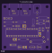

### 5.11 15 pF ceramics: C7, C8
`C315C150J1G5TA` · marked **150** · not polarized

The two sit just right of the socket's top-right corner. Check the 150 marking before fitting each one.

### 5.12 Headers: JP1 (1×2), J4 (1×3), J5 (1×4)
`PRPC040SAAN-RC`, snapped from the strip

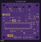

Solder one pin, check the header is square to the board, then solder the rest. Park the JP1 shunt on **one pin only**.

### 5.13 U2 regulator

> ⚠️ **Orientation.** The flat face goes toward the board's centre (away from the bottom edge), matching the flat line on the silkscreen.

If you're fitting the AP7381-50V-A, check its datasheet pinout matches the LM2936Z-5.0 first: 1 = OUT (the square pad), 2 = GND, 3 = IN.

### 5.14 C4 22 µF tantalum
`T350F226K016AT`

> ⚠️ **Polarity.** The **+** lead goes in the square pad, on the left. A reversed tantalum fails hard.

### 5.15 C6 10 µF electrolytic
`EEA-FC1E100`

> ⚠️ **Polarity.** The long lead (+) goes in the square pad, on the left. The stripe (−) goes to the right.

### 5.16 J3 Micro-Fit header
`43045-0200`

Seat the peg fully and solder both pins.

The case assumes the header is **10.3 mm tall**, measured from the board top to the top of the housing. Check yours with calipers before printing; see [the case README](../hardware/enclosure/README.md#before-printing-measure-j3).

### 5.17 J1 BODY and J2 HEAD, last
`615004143821`

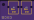

1. Seat the pegs and press the jack faces flush with the board edge.
2. Solder one pin on each jack, then check they're still flush.
3. Solder the rest.

> ⚠️ **Bridges.** The four pins are staggered and close together. Check every gap with a loupe, and wick any bridge.

## 6. Trim, clean, inspect

- [ ] **Trim** all leads to about 1 mm. The case leaves 4 mm under the board.
- [ ] **Clean** off the flux with isopropyl alcohol and a brush, then let the board dry fully. Water won't remove rosin. Pay the most attention to the ILL area (top right), where leftover flux undermines the isolation.
- [ ] **Glue Y1's can** to the board with a small dab of neutral-cure RTV silicone. Don't use acid-cure silicone (the kind that smells of vinegar). It needs about 24 h to cure before the case is closed.
- [ ] **Inspect** every joint for bridges, dull or cracked (cold) joints, and pins with no solder.
- [ ] **Short checks:** neither reading should be near 0 Ω. The capacitors charge from the meter, so the reading climbs; that's fine.

  | Probe | Expected |
  |---|---|
  | R1 left lead ↔ TP2 (PB to GND) | not near 0 Ω |
  | socket pin 20 ↔ pin 21 (5 V to GND) | not near 0 Ω |

## 7. Power checks (AVR out)

U1 stays out of its socket for this section.

**Socket pin numbering:** pin 1 is bottom-left, pins 1–14 run along the bottom row left to right, and pins 15–28 run along the top row right to left.

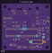

- [ ] **Power the board:**
  - Bench supply at 10 V with a 30 mA limit, output off. Or a 9 V battery.
  - **+ to R1's left lead, − to TP2.** That is the PB input. Never power the board from the programmer.
  - Turn the output on.

  | Check | Expected |
  |---|---|
  | supply current | under 1 mA |
  | socket pin 20 ↔ pin 21 | 5.0 V |
  | socket pins 6 and 14 ↔ TP2 | 5.0 V |

  > **STOP** if the supply hits its current limit, or 5 V is missing or wrong. Turn the output off and check:
  > - U2's orientation
  > - C4 and C6 polarity
  > - bridges near the power section

- [ ] **Lights input.** Leave the board powered. Connect J3 to the same supply: **J3 pin 1 to +, J3 pin 2 to −**. J3 is isolated from the rest of the board, so sharing the supply is fine. Anything from 9 to 14 V works.

  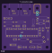

  | J3 | Socket pin 7 ↔ TP2 |
  |---|---|
  | powered | under 0.4 V |
  | disconnected | ≈ 5 V |

- [ ] Disconnect everything.

## 8. Program the AVR

The firmware build and flash commands are in [`firmware/README.md`](../firmware/README.md).

1. **Fit U1.**
   - Straighten its legs to 0.3 in by rolling each row against the bench.
   - **Notch to the left**, matching the socket.
   - Wrist strap on.
2. **Power the board** as in §7: 10 V or 9 V on R1's left lead and TP2.
3. **Connect the programmer to J4.**

   

   | J4 pin | Signal | Connect |
   |---|---|---|
   | 1 | GND | programmer GND (the **GND** pin, not DTR or CTS beside it) |
   | 2 | UPDI | UPDI Friend's UPDI pin, or the FT232's **RXD** |
   | 3 | log out | nothing yet |

   - **FT232 instead of a UPDI Friend:** put a 2.2 kΩ resistor between the adapter's TXD and RXD, and connect RXD to J4 pin 2. Set the adapter's jumper to 5 V.
   - **Never connect the programmer's power pin.** The board is powered only through PB.

4. **Run `make fuses`, then `make flash`.** Both should end with "Verify successful".
   - If you get "UPDI initialisation failed": first check that the adapter's GND really goes to J4 pin 1. Then loop the adapter's TXD to its RXD and run `firmware/tools/serial_loopback.py`. Some cheap CH340 modules fail that test and can't program at all.
5. **Read the log.**
   - Move the adapter to **RXD → J4 pin 3, GND → J4 pin 1**, with **nothing on TXD**. An idle-high TXD back-powers the AVR through its pins whenever the board is off.
   - Run `make log`, then turn the board's supply off and on.

   | Line | Means |
   |---|---|
   | `KP v1 rw=1 …` | the AVR is running the full firmware |
   | `X 1` (after about 2 s) | the crystal is running. `X 0` means check Y1's joints. |
   | `M n` / `M d` when J3 is powered or unpowered | the lights input reaches the AVR |

6. Supply off. Unplug the programmer.

## 9. Radio check

This is the safety check before the head is connected. It catches anything that would put the radio's 10 V on a data pin.

1. **Radio off. U1 fitted, JP1 parked on one pin.**
2. **Plug in only the body cable**, into J1. Radio on.
3. **Measure each J2 pin to TP2** at its solder joint on the underside.

   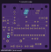

   | J2 pin | Expected |
   |---|---|
   | 1 (PB) | ≈ 10 V |
   | 2 (GND) | 0 V |
   | 3 (data to the head, from the AVR through R2) | ≈ 5 V |
   | 4 (data from the head, straight to the body) | ≈ 5 V |

   > **STOP** if 10 V appears on any pin other than pin 1. Unplug the radio and don't connect the head.

4. **Radio off.** Plug the head cable into J2. **Radio on.**
   - Expect the radio to start and work normally: display, keys, brightness menu.

**J5 data taps (optional).** J5 carries copies of the data lines for a logic analyzer or a USB-serial adapter's RX pin. It's listen-only: never drive these pins. Pins 2 and 3 come through 10 kΩ, and pin 4 after R2.

| J5 pin | Signal |
|---|---|
| 1 | GND |
| 2 | body → head, as the body sends it |
| 3 | head → body |
| 4 | what the head receives, after the AVR |

All of them run at 57,600 baud, 8N1, idle high.

## 10. Case and installation

Print and assemble the case as described in [`hardware/enclosure/README.md`](../hardware/enclosure/README.md).

- [ ] **Finish first.** Y1's glue must have cured and the firmware must be final. J4, J5 and JP1 are sealed inside the case.
- [ ] **Assemble:**
  1. Set the board on the base standoffs.
  2. Lower the cover over the connectors.
  3. Drive the 4 × M3 screws in from below, into the cover posts. They cut their own thread: tighten until snug, then stop.
- [ ] **Install** in the vehicle:
  - body cable → J1
  - head cable → J2
  - J3 → ILL+ (TAIL: live with the parking lights or headlights) and chassis ground. Reversed J3 wiring is harmless (D1 protects the opto), but the lights input won't work.
  - On 2003–2014 Toyotas (including the Tacoma), tap ILL+ and ground through a harness adapter that plugs into the factory radio connector, such as the [RED WOLF 20-pin steering wheel control harness](https://www.amazon.com/dp/B09S33B8L1). Confirm ILL+ with a meter: 11–14 V with the parking lights on, under 1 V off.
- [ ] **Set the two brightness levels:** pick a brightness in the radio's menu with the lights off, then pick one with the lights on. The board remembers both levels and switches between them with the lights.

## 11. Recovery

- **Hard bypass:** radio off, pull U1, move the JP1 shunt onto both pins. The radio then runs as if the board weren't there.
  - Fit the JP1 shunt **only with U1 removed**: with the AVR running, the two fight over the head's data line.
- **Known-good coupler:** a spare board fitted with only J1, J2 and a JP1 shunt.
- **Store-bought RJ couplers:** many are reversed (pin 1 to pin 4), which puts PB on a data pin. Check one pin for pin with a meter before using it.
